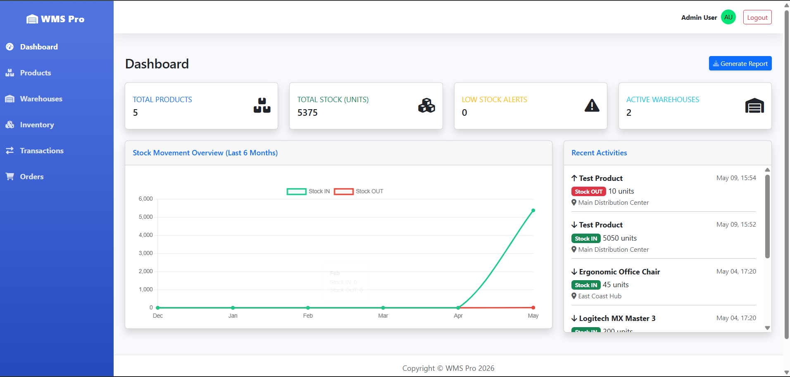

<h1 align="center">
  <br>
  🏭 WMS Pro
  <br>
  Warehouse Management System
  <br>
</h1>

<p align="center">
  <b>نظام إدارة المستودعات الاحترافي — مبني بأحدث تقنيات .NET 10</b>
</p>

<p align="center">
  
  
  
  
  
  
  
</p>

---

## 📸 لقطات من النظام

| Dashboard | Products | Warehouses |
|:---------:|:--------:|:----------:|
|  |  |  |

| Inventory | Transactions | Orders |
|:---------:|:------------:|:------:|
|  |  |  |

---

## 🚀 نظرة عامة

**WMS Pro** هو نظام إدارة مستودعات (Warehouse Management System) احترافي ومتكامل، مصمم لمساعدة الشركات على إدارة مخزونها بكفاءة عالية ودقة تامة. يجمع النظام بين قوة **RESTful API** ومرونة **MVC Web Application** ليوفر تجربة استخدام سلسة ولوحة تحكم ذكية.

### ✨ أبرز الميزات

- 📊 **لوحة تحكم ذكية (Dashboard):** عرض مؤشرات الأداء الرئيسية (KPIs) مع رسوم بيانية تفاعلية لحركات المخزون
- 📦 **إدارة المنتجات:** إضافة وتعديل وحذف المنتجات مع تصنيف بـ SKU وتتبع الكميات
- 🏢 **إدارة المخازن:** بطاقات تفاعلية لكل مخزن مع عرض الطاقة الاستيعابية ومعدل الاستخدام
- 🔄 **حركات المخزون:** دعم عمليات (الوارد IN / الصادر OUT / التحويل TRANSFER) مع التحقق الآلي من توفر الكمية
- 📋 **إدارة الطلبات:** طلبات شراء (Purchase) وطلبات بيع (Sales) مع تتبع الحالة وتأثير الطلب المكتمل على المخزون آليًا
- 🔒 **نظام أمان متطور:** مصادقة JWT مع إدارة أدوار (Manager / Warehouse Employee)
- 📤 **تصدير البيانات:** إمكانية تصدير تقارير المخزون والحركات

---

## 🏗️ هيكل المشروع (Architecture)

يعتمد المشروع على **Clean Architecture** مدمجاً بمبادئ **Domain-Driven Design (DDD)**، مما يضمن فصل المسؤوليات وسهولة الصيانة والتوسع.

```
WMSPro/
│
├── src/
│   ├── 🔵 WMSPro.Domain          # طبقة النطاق — Entities, Enums, Domain Events
│   ├── 🟢 WMSPro.Application     # طبقة التطبيق — CQRS (MediatR), DTOs, Interfaces
│   ├── 🟡 WMSPro.Infrastructure  # طبقة البنية التحتية — EF Core, Repositories, JWT Auth
│   ├── 🔴 WMSPro.Api             # RESTful Web API — Swagger, API Controllers
│   └── 🟣 WMSPro.Mvc             # Web Application — MVC Views, UI Controllers
│
└── tests/
    ├── 🧪 WMSPro.UnitTests        # اختبارات الوحدة
    └── 🧪 WMSPro.IntegrationTests # اختبارات التكامل
```

### مخطط التبعيات (Dependency Flow)

```
WMSPro.Mvc  ──────┐
                  ▼
WMSPro.Api  ──► WMSPro.Infrastructure ──► WMSPro.Application ──► WMSPro.Domain
```

### الكيانات الأساسية (Core Entities)

| الكيان | الوصف |
|--------|-------|
| `Product` | المنتج — SKU، الفئة، السعر، الكمية |
| `Warehouse` | المخزن — الموقع، الطاقة، المدير |
| `WarehouseStock` | مخزون منتج في مخزن محدد |
| `InventoryTransaction` | حركة المخزون (IN / OUT / TRANSFER) |
| `Order` + `OrderItem` | طلب الشراء/البيع مع بنوده |

---

## 🛠️ التقنيات المستخدمة (Tech Stack)

### Backend
| التقنية | الإصدار | الدور |
|---------|---------|------|
| .NET | 10.0 | Framework الرئيسي |
| ASP.NET Core Web API | 10.0.7 | بناء RESTful APIs |
| ASP.NET Core MVC | 10.0.7 | واجهة المستخدم |
| Entity Framework Core | 10.0.7 | ORM وقواعد البيانات |
| ASP.NET Core Identity | 10.0.7 | إدارة المستخدمين والأدوار |
| JWT Bearer Auth | 10.0.7 | المصادقة والتفويض |
| MediatR | 14.1.0 | تطبيق نمط CQRS |

### Frontend
| التقنية | الدور |
|---------|------|
| HTML5 / CSS3 | هيكل وتنسيق الواجهة |
| JavaScript | التفاعلية والـ Modals |
| Bootstrap | تصميم متجاوب (Responsive) |
| Chart.js | الرسوم البيانية التفاعلية |

### قاعدة البيانات
| التقنية | الدور |
|---------|------|
| SQL Server | قاعدة البيانات الرئيسية |
| EF Core Migrations | إدارة تحديثات البيانات |

### أنماط التصميم المطبقة
- ✅ **Clean Architecture** — فصل المسؤوليات بشكل هرمي
- ✅ **Domain-Driven Design (DDD)** — Rich Domain Models
- ✅ **CQRS Pattern** — عبر MediatR لفصل عمليات القراءة والكتابة
- ✅ **Result Pattern** — إدارة الأخطاء بدون Exceptions
- ✅ **Repository Pattern** — تجريد طبقة البيانات
- ✅ **Unit of Work** — ضمان تكامل العمليات (Database Transactions)
- ✅ **Domain Events** — `OrderCompletedEvent` لتحديث المخزون آليًا

---

## ⚙️ متطلبات التشغيل (Prerequisites)

- [.NET 10 SDK](https://dotnet.microsoft.com/download/dotnet/10.0)
- [SQL Server](https://www.microsoft.com/en-us/sql-server/sql-server-downloads) (أو SQL Server Express)
- [Visual Studio 2022+](https://visualstudio.microsoft.com/) أو [VS Code](https://code.visualstudio.com/)
- [Git](https://git-scm.com/)

---

## 🚀 طريقة التشغيل (Getting Started)

### 1. استنساخ المشروع
```bash
git clone https://github.com/your-username/WMSPro.git
cd WMSPro/WMSPro
```

### 2. إعداد قاعدة البيانات
افتح ملف `appsettings.json` في مشروع **WMSPro.Api** وعدّل Connection String:
```json
{
  "ConnectionStrings": {
    "DefaultConnection": "Server=.;Database=WMSProDb;Trusted_Connection=True;TrustServerCertificate=True;"
  }
}
```

### 3. تطبيق Migrations
```bash
# من داخل مجلد WMSPro
dotnet ef database update --project src/WMSPro.Infrastructure --startup-project src/WMSPro.Api
```

### 4. تشغيل المشروع

#### الطريقة السريعة (Windows)
```bash
# شغّل الملف المرفق مباشرة
run.bat
```

#### الطريقة اليدوية (Terminal)
```bash
# Terminal 1 — تشغيل الـ API
cd src/WMSPro.Api
dotnet run --urls=https://localhost:7000

# Terminal 2 — تشغيل الـ MVC
cd src/WMSPro.Mvc
dotnet run --urls=https://localhost:7001
```

### 5. الوصول للتطبيق

| الخدمة | الرابط |
|--------|--------|
| 🌐 Web Application (MVC) | https://localhost:7001 |
| 📡 API | https://localhost:7000 |
| 📄 Swagger UI | https://localhost:7000/swagger |

---

## 👤 بيانات الدخول الافتراضية (Seed Data)

| الدور | البريد الإلكتروني | كلمة المرور |
|-------|-------------------|-------------|
| Manager | admin@wmspro.com | Admin@123 |
| Warehouse Employee | employee@wmspro.com | Employee@123 |

> ⚠️ **تنبيه:** غيّر كلمات المرور الافتراضية فور تشغيل النظام في بيئة الإنتاج.

---

## 📐 مخطط الوحدات (Modules Overview)

```
📊 Dashboard
 └── KPI Cards (Products, Stock, Low Stock Alerts, Warehouses)
 └── Stock Movement Line Chart
 └── Stock IN vs OUT Bar Chart
 └── Recent Activities Table

📦 Products
 └── Search by Name / SKU
 └── Add / Edit / Delete (Modal Forms)

🏢 Warehouses
 └── Card Grid View with Capacity Progress Bar
 └── Add / Edit (Modal Forms)

📋 Inventory
 └── Filter by Product & Warehouse
 └── Export to CSV

🔄 Transactions
 └── Summary Cards (IN / OUT / Transfers)
 └── Filter by Type & Search
 └── Export to CSV

🛒 Orders
 └── Purchase Orders & Sales Orders
 └── Status Management (Pending → Processing → Completed)
 └── Auto Inventory Update on Completion (Domain Event)

🔒 Authentication
 └── Register with Role Selection
 └── JWT Token (stored in Cookies for MVC)
 └── Role-based Authorization (Manager / Employee)
```

---

## 🧪 الاختبارات (Tests)

```bash
# تشغيل جميع الاختبارات
dotnet test

# اختبارات الوحدة فقط
dotnet test tests/WMSPro.UnitTests

# اختبارات التكامل
dotnet test tests/WMSPro.IntegrationTests
```

---

## 🗂️ هيكل الكود (Code Structure — Application Layer)

```
WMSPro.Application/
├── Abstractions/        # Interfaces (IUnitOfWork, IRepository...)
├── Auth/                # Login & Register Commands + Handlers
├── Dashboard/           # Dashboard Query + Handler
├── Products/            # CRUD Commands & Queries
├── Warehouses/          # CRUD Commands & Queries
├── Transactions/        # CreateTransaction Command (with Business Rules)
└── Orders/              # CreateOrder, UpdateStatus Commands & Queries
```

---

## 🤝 المساهمة (Contributing)

المساهمات مرحب بها! اتبع الخطوات التالية:

1. Fork المشروع
2. أنشئ Branch جديد: `git checkout -b feature/amazing-feature`
3. Commit التعديلات: `git commit -m 'Add amazing feature'`
4. Push: `git push origin feature/amazing-feature`
5. افتح Pull Request

---

## 📜 الترخيص (License)

هذا المشروع مرخص تحت رخصة **MIT** — راجع ملف [LICENSE](LICENSE) للتفاصيل.

---

## 👨‍💻 المطور

<p align="center">
  <b>Mohamed Ashraf Abdul Kareem</b><br>
  Full Stack .NET Developer<br>
  <a href="https://github.com/Mohamed68909">GitHub</a> •
  <a href="https://www.linkedin.com/">LinkedIn</a>
</p>

---

<p align="center">
  صُنع بـ ❤️ باستخدام <b>.NET 10</b>
</p>
